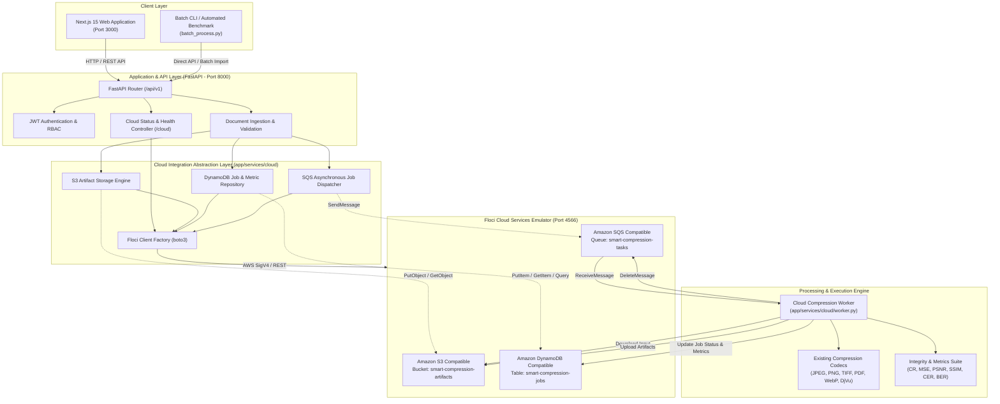

# Smart Compression Analyzer × Floci — Cloud Architecture

## 1. System Overview

**Smart Compression Analyzer** is a high-performance document compression benchmarking and integrity analysis system. The cloud-enhanced version incorporates an AWS-compatible cloud computing layer powered by **Floci** (a local cloud service emulator running on port `4566`).

The architecture operates in two configurable modes:
- **`LOCAL` Mode (`CLOUD_MODE=local`):** Uses the original local SQLite database, local filesystem storage (`uploads/_local_storage`), and optional eager Celery execution without requiring cloud infrastructure.
- **`FLOCI` Cloud Mode (`CLOUD_MODE=floci`):** Utilizes standard AWS wire-protocol APIs via `boto3` directed to Floci at `http://localhost:4566`:
  - **Amazon S3 API:** Stores raw uploaded documents and generated compression artifacts (JPEG, PNG, TIFF, PDF, WebP, DjVu rasters).
  - **Amazon DynamoDB API:** Stores compression job metadata, runtime status, format-specific benchmarks, and forensic integrity records.
  - **Amazon SQS API:** Provides decoupled asynchronous task queueing for worker-based compression job processing.

---

## 2. Architectural Diagram

---

## 3. Component Responsibilities

### 3.1 Amazon S3 (Artifact Storage)
- **Bucket:** `smart-compression-artifacts` (or configured via `S3_BUCKET`).
- **Object Key Namespaces:**
  - `uploads/{uuid}/{filename}`: Original document inputs.
  - `references/{uuid}/ref_1000x1414.png`: Standardized preprocessed grayscale rasters.
  - `stego/{uuid}/stego_payload.png`: Preprocessed raster embedded with 968-bit LSB steganography watermark.
  - `compressed/{uuid}/{format}/{filename}`: Encoded output files across all evaluated codecs.
  - `reconstructed/{uuid}/{format}/recon.png`: Decoded grayscale rasters for metric comparison.
- **Resilience:** Built-in retry loops with exponential backoff and presigned URL generation for client downloads.

### 3.2 Amazon DynamoDB (Metadata & Run Results)
- **Table:** `smart-compression-jobs` (or configured via `DYNAMODB_TABLE`).
- **Primary Key:** `job_id` (String / UUID).
- **Attributes Stored:**
  - `job_id`: Unique identifier for the compression job.
  - `user_id`: Identifier of submitting user.
  - `filename`: Original file name.
  - `file_size_bytes`: Original input byte size.
  - `checksum_sha256`: Cryptographic digest.
  - `status`: `PENDING` | `PROCESSING` | `COMPLETED` | `FAILED`.
  - `created_at` / `completed_at`: ISO-8601 UTC timestamps.
  - `execution_duration_ms`: Total execution wall-clock time.
  - `embedding_psnr`: Fidelity of steganographic embedding.
  - `formats`: Map of format-specific records (CR, MSE, PSNR, SSIM, OCR CER, BER, payload recovery percentage, encoding/decoding duration).
  - `error_message`: Captured stack trace or diagnostic details upon failure.

### 3.3 Amazon SQS (Task Queue)
- **Queue Name:** `smart-compression-tasks` (or configured via `SQS_QUEUE_NAME`).
- **Message Payload:** JSON object containing `job_id`, `s3_key`, `filename`, and processing directives.
- **Worker Execution:** Worker polls queue with long polling (`WaitTimeSeconds=10`), downloads input from S3, invokes existing `run_pipeline()`, stores artifacts back in S3, persists metrics in DynamoDB, and acknowledges message deletion.

### 3.4 Worker Execution (Local & Containerized)
- Reuses original compression codecs and metrics from `compression_codecs/`, `metrics/`, and `utils/`.
- Zero duplication of compression math or algorithms.
- Can run as a standalone Python process (`python -m app.services.cloud.worker`) or containerized in Docker Compose.

---

## 4. Multi-Mode Configuration

The application uses standard environment variables:

| Variable | Default (Local) | Floci Integration | Description |
|---|---|---|---|
| `CLOUD_MODE` | `local` | `floci` | Switches between local filesystem and Floci AWS services |
| `AWS_ENDPOINT_URL` | `http://localhost:4566` | `http://floci:4566` (in Docker) | Floci emulator base endpoint |
| `AWS_REGION` | `us-east-1` | `us-east-1` | AWS region configuration |
| `AWS_ACCESS_KEY_ID` | `test` | `test` | Emulated access key ID |
| `AWS_SECRET_ACCESS_KEY` | `test` | `test` | Emulated secret key |
| `S3_BUCKET` | `smart-compression-artifacts` | `smart-compression-artifacts` | S3 bucket for documents and artifacts |
| `DYNAMODB_TABLE` | `smart-compression-jobs` | `smart-compression-jobs` | DynamoDB table for job records |
| `SQS_QUEUE_NAME` | `smart-compression-tasks` | `smart-compression-tasks` | SQS queue for task dispatch |
